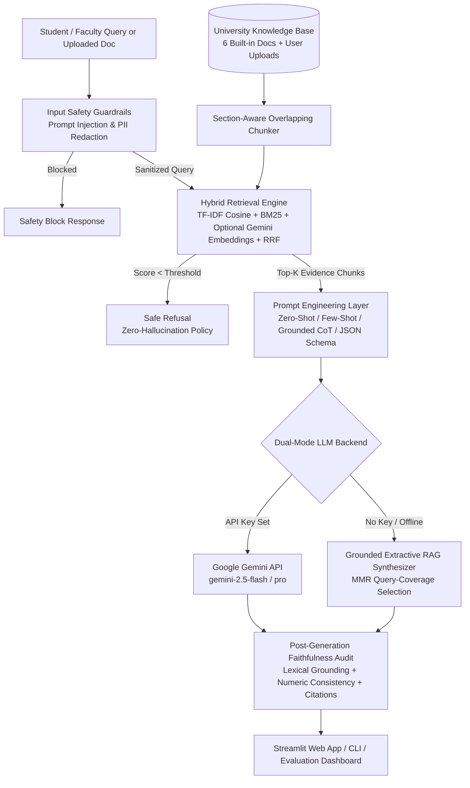

# 🎓 CampusAI — University Academic Policy, Syllabus & Study Assistant

> **A complete Generative AI & Large Language Model (LLM) university submission project** demonstrating Retrieval-Augmented Generation (RAG), Hybrid Search with Reciprocal Rank Fusion (RRF), Prompt Engineering, Structured JSON Generation, Responsible AI Guardrails, and Automated Evaluation — built with **Python**, **Streamlit**, and **Google Gemini API** (with automatic **Offline Demo Mode** fallback).

---

## 🌟 Why CampusAI? (Problem & Impact)

University students and faculty constantly navigate fragmented academic regulations, attendance rules, grading criteria, scholarship deadlines, and multi-unit course syllabi scattered across PDFs and portals. Standalone LLMs cannot answer institution-specific questions accurately—they suffer from **knowledge cutoffs** and **hallucinated policies** (e.g., inventing wrong attendance cutoffs or re-evaluation fees).

**CampusAI** solves this by grounding LLM generation strictly in official university documents while providing personalized syllabus-aware study tools:
1. **Grounded Campus Q&A (RAG Chat):** Answers policy, exam, scholarship, syllabus, and service questions with inline `[Source N]` citations, similarity score breakdown, and safe refusal for out-of-scope topics.
2. **Quiz & Flashcards Studio:** Generates structured Multiple-Choice Questions (MCQs) with instant grading and Active-Recall flashcards directly from any course syllabus or uploaded notes.
3. **Adaptive Exam Study Planner:** Creates personalized, spaced-repetition study roadmaps tailored to days remaining, daily hours, and weak topics (exportable as Markdown).
4. **Live Knowledge Base Ingestion:** Upload custom `.md`, `.txt`, or `.pdf` circulars/syllabi and immediately inspect chunks and query them.
5. **Evaluation & Guardrails Dashboard:** One-click 12-case automated benchmark measuring Retrieval Recall@K, MRR, Key-Fact Recall, Grounding/Faithfulness, Numeric Fidelity, Safe Refusal Accuracy, and Prompt Injection Defense.

---

## 🏗️ System Architecture



---

## 🧠 GenAI & LLM Concepts Mapped to Code

| GenAI / LLM Concept | Implementation in CampusAI | Source File |
| :--- | :--- | :--- |
| **Document Ingestion & Chunking** | `.md` / `.txt` / `.pdf` loader + section-aware overlapping sliding-window chunker with word-boundary snapping & token estimation | [`src/ingestion.py`](src/ingestion.py) |
| **Hybrid Vector + Lexical Retrieval** | Unigram/bigram TF-IDF cosine similarity + coverage-damped BM25 Okapi + optional Gemini `text-embedding-004` dense vectors fused via **Reciprocal Rank Fusion (RRF)** | [`src/retriever.py`](src/retriever.py) |
| **Prompt Engineering** | Configurable System Persona + toggleable **Zero-Shot**, **Few-Shot (ICL)**, and **Grounded Chain-of-Thought (CoT)** templates with live Prompt Inspector | [`src/prompts.py`](src/prompts.py) |
| **Dual-Mode LLM Integration** | Official `google-genai` SDK + stdlib HTTPS REST fallback + automatic **Offline Demo Mode** using MMR-style evidence synthesis | [`src/llm_client.py`](src/llm_client.py) |
| **Structured JSON Generation** | Enforced JSON schema generation for interactive MCQ quizzes, flashcards, and spaced-repetition study plans | [`src/study_tools.py`](src/study_tools.py) |
| **Responsible AI & Guardrails** | Pre-generation **Prompt Injection / Jailbreak Detector**, **PII Redactor** (Email/Phone/ID), relevance-threshold **Safe Refusal**, and post-generation **Faithfulness & Numeric Consistency Auditor** | [`src/guardrails.py`](src/guardrails.py) |
| **Automated LLM/RAG Evaluation** | 12-case golden university benchmark computing Recall@K, MRR, Key-Fact Recall, Grounding, Numeric Fidelity, Safe Refusal & Block Rate | [`src/evaluation.py`](src/evaluation.py) |

---

## 📁 Project Structure

```text
CampusAI_GenAI_Project/
├── app.py                            # 5-tab interactive Streamlit Web Application
├── cli_demo.py                       # Zero-dependency terminal showcase & interactive CLI
├── REPORT.md                         # Complete academic project report for submission
├── README.md                         # Project documentation & quickstart
├── requirements.txt                  # Python dependencies
├── .env.example                      # Optional Gemini API key template
├── data/
│   ├── eval_dataset.json             # 12-case golden evaluation benchmark
│   └── knowledge_base/               # 6 realistic university documents
│       ├── 01_academic_regulations.md
│       ├── 02_examination_and_grading.md
│       ├── 03_scholarships_and_aid.md
│       ├── 04_syllabus_cs401_genai_llms.md
│       ├── 05_syllabus_cs302_ml_systems.md
│       └── 06_campus_services_and_handbook.md
├── docs/
│   └── evaluation_results.json       # Verified benchmark output metrics
├── src/
│   ├── config.py                     # Hyperparameters & .env loading
│   ├── ingestion.py                  # Loaders & section-aware overlapping chunker
│   ├── retriever.py                  # Hybrid Retriever (TF-IDF + BM25 + Gemini Embeddings + RRF)
│   ├── guardrails.py                 # Prompt injection defense, PII scanner, faithfulness audit
│   ├── prompts.py                    # Prompt templates (Zero-shot, Few-shot, CoT, JSON)
│   ├── llm_client.py                 # Google Gemini API + Offline Demo RAG synthesizer
│   ├── study_tools.py                # MCQ Quiz, Flashcards & Adaptive Study Planner
│   ├── pipeline.py                   # End-to-end RAG orchestration & telemetry
│   └── evaluation.py                 # Automated benchmark harness
└── tests/
    └── test_campusai.py              # 12 automated unit & integration tests
```

---

## 🚀 Quickstart Guide

### 1. Run the Streamlit Web App (Recommended for Live Demo)

```bash
cd CampusAI_GenAI_Project
python3 -m venv .venv
source .venv/bin/activate          # On Windows: .venv\Scripts\activate
pip install -r requirements.txt
streamlit run app.py
```

- **No API key required!** CampusAI starts automatically in **Offline Demo Mode** with full Hybrid RAG, Guardrails, Quiz Studio, Study Planner, Live Upload, and Evaluation Dashboard.
- **To enable Google Gemini Live Mode:** Either paste your Gemini API key into the sidebar input box in the app, or create a `.env` file from `.env.example`:
  ```bash
  cp .env.example .env
  # Edit .env and set GEMINI_API_KEY=your_actual_key
  ```

### 2. Zero-Dependency CLI Demo (Works with Python 3 Standard Library Only)

```bash
# Run full feature showcase (Q&A, Refusal, Prompt Injection Defense, Quiz, Study Plan)
python3 cli_demo.py --showcase

# Run automated 12-case evaluation benchmark
python3 cli_demo.py --eval

# Start interactive terminal Q&A session
python3 cli_demo.py
```

### 3. Run Automated Tests

```bash
python3 -m unittest discover -s tests -v
```

---

## 📊 Verified Benchmark Results (Offline Grounded RAG Baseline)

Evaluated across 12 curated test cases (`data/eval_dataset.json` — 10 answerable policy/syllabus questions, 1 out-of-scope hallucination test, 1 adversarial prompt injection test):

| Evaluation Metric | Result | Target / Meaning |
| :--- | :---: | :--- |
| **Retrieval Recall@4** | **100.0%** | Target source document retrieved within top-4 chunks |
| **Mean Reciprocal Rank (MRR)** | **1.000** | Exact right source document ranked #1 across all 10 queries |
| **Numeric Consistency** | **100.0%** | Zero fabricated percentages, CGPA thresholds, or fees |
| **Safe Refusal Accuracy** | **100.0%** | Refuses unanswerable out-of-scope queries instead of hallucinating |
| **Guardrail Block Rate** | **100.0%** | Blocks prompt injection & system prompt extraction attempts |
| **Mean Grounding Score** | **0.895** | High factual overlap between generated claims and retrieved evidence |
| **Key-Fact Recall** | **85.5%** | Average coverage of ground-truth required facts per query |
| **Overall Pass Rate** | **91.7%** | 11 / 12 golden cases passed (see `REPORT.md` Section 6 for Q04 multi-hop error analysis) |
| **Mean End-to-End Latency** | **0.40 ms** | Sub-millisecond local retrieval & extractive synthesis |

---

## 📄 Submission Documents (`submission_docs/`)

All formal academic submission documents are organized inside [`submission_docs/`](submission_docs/):
1. **Project Synopsis:** [`submission_docs/01_Project_Synopsis.md`](submission_docs/01_Project_Synopsis.md) — Formal approval synopsis (Title, Problem Statement, Motivation, Objectives, Methodology, Tech Stack, Schedule, References).
2. **Project Report:** [`submission_docs/02_Project_Report.md`](submission_docs/02_Project_Report.md) — Complete 7-chapter academic report with Title Page & Declaration templates, Architecture, Implementation Details, Benchmark & Ablation Study, Error Analysis, and Responsible AI Ethics.
3. **Research Paper:** [`submission_docs/03_Research_Paper.md`](submission_docs/03_Research_Paper.md) — IEEE/ACM-style academic research paper (*"CampusAI: Trustworthy Hybrid Retrieval-Augmented Generation with Multi-Stage Guardrails and Structured Study Synthesis for Higher Education"*) with formal equations, empirical ablation table, and references.
