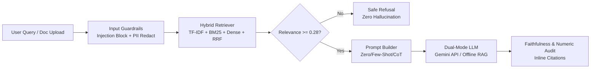

# PROJECT SYNOPSIS

## Title of the Project
**CampusAI: A Grounded Generative AI & Large Language Model Assistant for University Academic Policies, Course Syllabi, and Adaptive Study Support**

---

### Student & Institutional Details *(Fill before submission)*
- **Student Name:** \_\_\_\_\_\_\_\_\_\_\_\_\_\_\_\_\_\_\_\_\_\_\_\_\_\_\_\_
- **Roll Number / USN:** \_\_\_\_\_\_\_\_\_\_\_\_\_\_\_\_\_\_\_\_\_\_\_\_\_\_\_\_
- **Department:** Computer Science & Engineering / Artificial Intelligence & Machine Learning
- **Course / Subject:** Generative AI & Large Language Models (Capstone Project)
- **Project Guide:** \_\_\_\_\_\_\_\_\_\_\_\_\_\_\_\_\_\_\_\_\_\_\_\_\_\_\_\_
- **Academic Year:** 2026–2027

---

## 1. Introduction & Background
Higher education institutions publish vast volumes of academic regulations, examination handbooks, scholarship circulars, departmental syllabi, and campus service manuals. Students and faculty rely on these documents daily to make high-stakes academic decisions regarding attendance eligibility, grading criteria, financial aid renewals, and exam preparation. However, institutional knowledge is typically scattered across static PDFs and disconnected portals.

While Large Language Models (LLMs) such as Google Gemini and GPT have transformed conversational information access, deploying standalone LLMs in academic environments presents serious reliability hazards—including **hallucinated university rules**, **outdated parametric knowledge**, **absence of source citations**, and **susceptibility to prompt injection**. **CampusAI** bridges this gap by applying **Retrieval-Augmented Generation (RAG)**, **Hybrid Search with Reciprocal Rank Fusion (RRF)**, **Structured Prompt Engineering**, and **Responsible AI Guardrails** to deliver a trustworthy, auditable university assistant.

---

## 2. Problem Statement
Students and academic staff lack a unified, verifiable AI system that can:
1. Answer institution-specific policy and syllabus questions accurately with **zero fabricated numerical thresholds** (such as attendance percentages, CGPA cutoffs, deadlines, and fees).
2. Cite exact source sections transparently and **refuse to answer** when requested information is absent from official university records.
3. Transform course syllabi and uploaded lecture notes into interactive **active-recall quizzes**, **flashcards**, and **personalized exam study schedules**.
4. Defend against **prompt injection attacks** and **Personally Identifiable Information (PII)** leakage before invoking external LLM APIs.

---

## 3. Motivation
- **Eliminating Academic Misinformation:** Misinterpreting a single threshold (e.g., 75% mandatory attendance vs. 65%–74.9% condonation eligibility, or 35% independent End-Semester Exam passing criteria) can lead to course detention or scholarship forfeiture.
- **Reducing Administrative Load:** Automating repetitive policy and syllabus inquiries frees faculty advisors and academic offices to focus on complex student mentoring.
- **Promoting Ethical, Formative AI Use:** Aligning with institutional Generative AI policies by focusing on concept mastery, self-assessment quizzes, and structured revision rather than automated assignment completion.

---

## 4. Objectives
1. **Curate and Ingest a Structured University Corpus:** Support `.md`, `.txt`, and `.pdf` policy handbooks and course syllabi via section-aware overlapping chunking.
2. **Design a Hybrid Retrieval Pipeline:** Combine unigram/bigram TF-IDF cosine similarity, coverage-damped BM25 Okapi ranking, course-code entity alignment, and optional Google Gemini dense embeddings (`text-embedding-004`) via Reciprocal Rank Fusion (RRF).
3. **Engineer Configurable Grounded Prompts & Dual-Mode Inference:** Implement Zero-Shot, Few-Shot In-Context Learning, and Grounded Chain-of-Thought prompting over the **Google Gemini API**, paired with a deterministic **Offline Demo Mode** fallback so the application runs reliably with or without an API key.
4. **Build Structured GenAI Study Tools:** Provide JSON-schema-driven MCQ quiz generation, active-recall flashcards, and personalized spaced-repetition study planners.
5. **Enforce Multi-Stage Responsible AI Guardrails:** Integrate prompt injection filtering, PII redaction, relevance-gated safe refusal, and post-generation faithfulness & numeric consistency verification.
6. **Quantitatively Evaluate System Reliability:** Build an automated 12-case benchmark measuring Retrieval Recall@K, MRR, Key-Fact Recall, Grounding Score, Numeric Fidelity, Safe Refusal Accuracy, and Guardrail Block Rate.

---

## 5. Proposed System & Methodology

CampusAI executes a six-stage verifiable pipeline on every user interaction:

### Core Modules
- **Ingestion & Chunking (`src/ingestion.py`):** Parses document headings and creates overlapping, word-boundary-aligned text chunks with section and token metadata.
- **Hybrid Retrieval (`src/retriever.py`):** Ranks chunks by fusing lexical (BM25), phrase-vector (TF-IDF), and optional dense semantic signals (`text-embedding-004`) via RRF.
- **Guardrails & Faithfulness (`src/guardrails.py`):** Blocks adversarial overrides, redacts emails/phone/ID numbers, and verifies that every generated percentage, CGPA, or fee appears verbatim in the retrieved evidence.
- **Dual-Mode Generation (`src/llm_client.py`):** Calls Google Gemini (`gemini-2.5-flash` / `pro`) when an API key is supplied, or seamlessly falls back to a Maximal Marginal Relevance (MMR) extractive synthesizer offline.
- **Study Studio (`src/study_tools.py`):** Produces structured interactive MCQs, flashcards, and downloadable study roadmaps from any syllabus.
- **Evaluation Harness (`src/evaluation.py`):** Runs automated regression and ablation testing against a golden university benchmark.

---

## 6. Tools, Technologies & Hardware Requirements

| Category | Technologies Used |
| :--- | :--- |
| **Programming Language** | Python 3.10+ |
| **Web Interface** | Streamlit (`app.py`) + Zero-Dependency CLI (`cli_demo.py`) |
| **LLM & Embeddings** | Google Gemini API (`google-genai` SDK + HTTPS REST fallback; `gemini-2.5-flash`, `text-embedding-004`) + Local Offline Extractive RAG |
| **Document Parsing** | Standard Library Markdown/Text Parser + `pypdf` for PDF ingestion |
| **Testing & Evaluation** | Python `unittest` / `pytest`, Automated JSON Benchmark Harness |
| **Hardware Requirements** | Standard laptop/desktop (8 GB RAM, CPU-only; no local GPU required) |

---

## 7. Scope & Real-World Applications
- **University Academic Helpdesks:** 24/7 verified student query resolution for registrars, examination cells, and financial aid offices.
- **Departmental Course Assistants:** Professors can upload course syllabi and lecture notes to automatically offer grounded Q&A, formative quizzes, and revision timetables.
- **Extensible Institutional Framework:** The architecture generalizes directly to municipal civic portals, hospital patient handbooks, and corporate compliance manuals.

---

## 8. Expected Outcomes & Achieved Validation
- A 5-tab interactive **Streamlit Web Application** and standalone **CLI Demo** operating seamlessly in both Live Gemini and Offline modes.
- Verified quantitative performance on the 12-case university benchmark:
  - **100.0% Retrieval Recall@4** and **1.000 Mean Reciprocal Rank (MRR)**
  - **100.0% Numeric Consistency** (zero fabricated policy figures)
  - **100.0% Safe Refusal Accuracy** on out-of-scope queries and **100.0% Guardrail Block Rate** on prompt injection attacks
  - **0.895 Mean Grounding Score** and **91.7% Overall Pass Rate**
- **12/12 passing automated unit and integration tests** (`tests/test_campusai.py`).

---

## 9. Tentative Project Schedule / Milestones

| Phase | Duration | Key Deliverables |
| :--- | :---: | :--- |
| **Phase 1: Problem Study & Corpus Curation** | Weeks 1–2 | Requirements analysis, 6 university knowledge-base documents, 12-case golden dataset |
| **Phase 2: Core RAG & Hybrid Retrieval** | Weeks 3–5 | Section-aware chunker, TF-IDF + BM25 + Gemini Embeddings + RRF retriever |
| **Phase 3: Prompting, Guardrails & Study Studio** | Weeks 6–8 | Prompt templates, safety filters, faithfulness scorer, Quiz/Flashcard/Study Planner |
| **Phase 4: UI Integration & Testing** | Weeks 9–10 | 5-tab Streamlit web app, CLI demo, 12 automated tests |
| **Phase 5: Evaluation, Ablation & Documentation** | Weeks 11–12 | Benchmark & ablation runs, Project Report, Research Paper, Final Demo |

---

## 10. References
1. Lewis, P., et al. (2020). *Retrieval-Augmented Generation for Knowledge-Intensive NLP Tasks*. NeurIPS.
2. Cormack, G. V., Clarke, C. L. A., & Buettcher, S. (2009). *Reciprocal Rank Fusion Outperforms Condorcet and Individual Rank Learning Methods*. SIGIR.
3. Robertson, S., & Zaragoza, H. (2009). *The Probabilistic Relevance Framework: BM25 and Beyond*. Foundations and Trends in Information Retrieval.
4. Wei, J., et al. (2022). *Chain-of-Thought Prompting Elicits Reasoning in Large Language Models*. NeurIPS.
5. Es, S., et al. (2023). *RAGAS: Automated Evaluation of Retrieval Augmented Generation*. arXiv:2309.15217.
