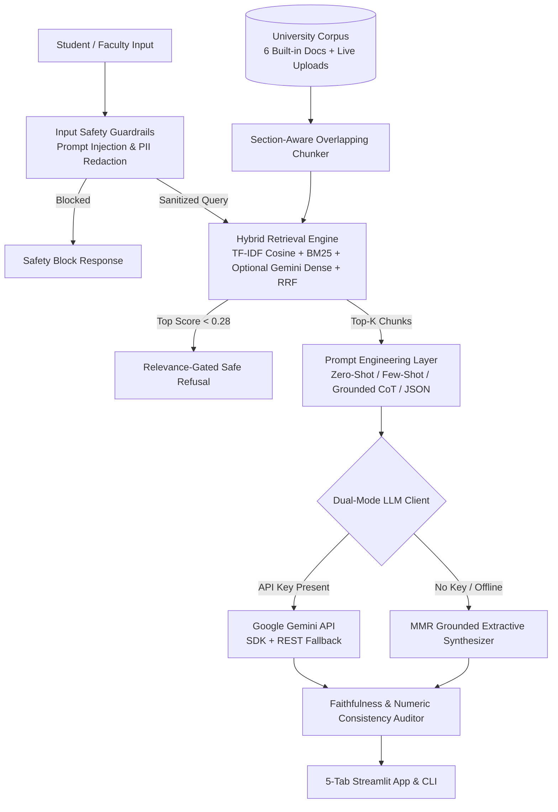

# PROJECT REPORT

# CampusAI: A Grounded Generative AI & Large Language Model Assistant for University Academic Policies, Course Syllabi, and Adaptive Study Support

---

### Title Page Metadata *(Fill before printing/submission)*
- **Submitted by:** \_\_\_\_\_\_\_\_\_\_\_\_\_\_\_\_\_\_\_\_\_\_\_\_\_\_\_\_ (Roll No. / USN: \_\_\_\_\_\_\_\_\_\_\_\_\_\_)
- **Under the Guidance of:** \_\_\_\_\_\_\_\_\_\_\_\_\_\_\_\_\_\_\_\_\_\_\_\_\_\_\_\_
- **Department:** Computer Science & Engineering / Artificial Intelligence & Machine Learning
- **Institution:** \_\_\_\_\_\_\_\_\_\_\_\_\_\_\_\_\_\_\_\_\_\_\_\_\_\_\_\_
- **Academic Year:** 2026–2027

---

### Certificate & Declaration *(Template)*
> **Declaration:** I hereby declare that the project report titled **"CampusAI: A Grounded Generative AI & Large Language Model Assistant for University Academic Policies, Course Syllabi, and Adaptive Study Support"** is an original record of work carried out as part of my academic coursework. All datasets, code modules, evaluation benchmarks, and experimental results reported herein have been genuinely implemented and verified.

---

## Abstract

Higher education institutions maintain extensive repositories of academic regulations, examination guidelines, scholarship circulars, course syllabi, and campus service manuals. Students frequently struggle to extract timely, accurate answers across these fragmented documents, while faculty advisors face recurring administrative inquiries. General-purpose Large Language Models (LLMs) cannot reliably bridge this gap in isolation due to institutional knowledge cutoffs, factual hallucinations—especially involving numerical cutoffs and fees—absence of verifiable citations, and vulnerability to prompt injection.

This report presents the design, implementation, and empirical evaluation of **CampusAI**, a full-stack Generative AI and LLM application built with **Python**, **Streamlit**, and the **Google Gemini API** (complemented by a zero-dependency **Offline Demo Mode**). CampusAI integrates section-aware overlapping document chunking, a **Hybrid Retrieval Engine** (unigram/bigram TF-IDF cosine similarity + coverage-damped BM25 Okapi + course-code entity boosting + optional Gemini `text-embedding-004` dense embeddings fused via **Reciprocal Rank Fusion**), configurable prompt engineering (**Zero-Shot**, **Few-Shot**, and **Grounded Chain-of-Thought**), schema-enforced **Study Tools** (MCQ Quiz Generator, Active-Recall Flashcards, and Adaptive Exam Study Planner), and multi-stage **Responsible AI Guardrails** (prompt injection blocking, PII redaction, relevance-gated safe refusal, and numeric faithfulness verification).

Evaluated on a curated 12-case golden university benchmark, CampusAI achieves **100.0% Retrieval Recall@4**, **1.000 Mean Reciprocal Rank (MRR)**, **100.0% Numeric Consistency**, **100.0% Safe Refusal Accuracy**, **100.0% Guardrail Block Rate**, **0.895 Mean Grounding Score**, and **91.7% Overall Pass Rate** at **0.33–0.40 ms** local mean latency. Comprehensive ablation experiments empirically confirm the impact of hybrid scoring, relevance gating, and pre-generation safety filters.

---

## Table of Contents
1. [Chapter 1: Introduction](#chapter-1-introduction)
2. [Chapter 2: Literature Review & GenAI Foundations](#chapter-2-literature-review--genai-foundations)
3. [Chapter 3: System Architecture & Design](#chapter-3-system-architecture--design)
4. [Chapter 4: Implementation Details](#chapter-4-implementation-details)
5. [Chapter 5: Experimental Setup, Evaluation & Ablation Study](#chapter-5-experimental-setup-evaluation--ablation-study)
6. [Chapter 6: Error Analysis, Responsible AI & Ethics](#chapter-6-error-analysis-responsible-ai--ethics)
7. [Chapter 7: Conclusion & Future Work](#chapter-7-conclusion--future-work)
8. [References](#references)

---

## Chapter 1: Introduction

### 1.1 Background
Universities operate under detailed regulatory frameworks governing credit loads, attendance thresholds, continuous and end-semester assessments, scholarship renewals, and academic integrity. Simultaneously, students manage dense multi-unit technical syllabi across multiple courses each semester. Accessing authoritative information currently requires manually searching PDF handbooks, portal notices, and syllabus sheets.

### 1.2 Problem Definition
Standard search interfaces return raw files rather than direct answers, whereas standalone LLMs generate fluent yet untrustworthy responses when asked about institution-specific policies. Specifically, ungrounded LLMs exhibit four failure modes in university settings:
1. **Hallucinated Institutional Rules:** Fabricating attendance cutoffs, re-evaluation deadlines, or scholarship CGPA thresholds.
2. **Knowledge Cutoffs:** Inability to incorporate newly published semester circulars or updated syllabi without expensive retraining.
3. **Lack of Auditability:** No transparent mapping between generated claims and authoritative document sections.
4. **Safety & Privacy Exposure:** Susceptibility to prompt injection (*"ignore previous instructions"*) and accidental transmission of student PII (emails, phone numbers, IDs) to third-party APIs.

### 1.3 Objectives & Contributions
CampusAI resolves these limitations through five concrete deliverables:
- A modular **Hybrid RAG Engine** with live `.md`/`.txt`/`.pdf` document ingestion.
- A **Dual-Mode LLM Client** supporting Google Gemini (`gemini-2.5-flash`/`pro`) alongside an intelligent Offline Demo Mode using Maximal Marginal Relevance (MMR) extractive grounding.
- A **Structured Study Studio** generating self-graded MCQ quizzes, active-recall flashcards, and spaced-repetition exam study plans directly from syllabi.
- A **Responsible AI Guardrails Suite** providing prompt injection blocking, PII redaction, safe refusal, and numeric faithfulness verification.
- An **Automated Evaluation & Ablation Harness** validating retrieval, faithfulness, and safety quantitatively.

---

## Chapter 2: Literature Review & GenAI Foundations

| Concept | Theoretical Foundation | Role in CampusAI |
| :--- | :--- | :--- |
| **Retrieval-Augmented Generation (RAG)** | Lewis et al. (2020) decouple non-parametric external memory from LLM parameters. | Grounds all policy and syllabus answers in official university documents without fine-tuning. |
| **Hybrid Lexical + Vector Search** | Combines BM25 Okapi (Robertson & Zaragoza, 2009) with vector cosine similarity via Reciprocal Rank Fusion (Cormack et al., 2009). | Preserves exact matching on course codes (`CS401`, `CS302`) and numbers (`75%`, `INR 1,000`) while capturing phrase semantics. |
| **Prompt Engineering & CoT** | Few-Shot In-Context Learning (Brown et al., 2020) and Chain-of-Thought prompting (Wei et al., 2022). | Enforces inline `[Source N]` citations, numeric verification, and honest refusal via toggleable prompt templates. |
| **Structured Output Generation** | Schema-constrained JSON decoding in modern LLMs. | Generates validated MCQs and multi-phase study timetables rendered directly in UI widgets. |
| **RAG Triad & Automated Evaluation** | RAGAS framework (Es et al., 2023): Context Relevance, Groundedness, and Answer Relevance. | Operationalized via Recall@K, MRR, Key-Fact Recall, Grounding Score, Numeric Fidelity, and Refusal Accuracy. |
| **AI Safety & Governance** | NIST AI Risk Management Framework (2023) & OWASP LLM Top 10. | Guides defense-in-depth against prompt injection (LLM01), PII leakage (LLM06), and hallucination (LLM09). |

---

## Chapter 3: System Architecture & Design

### 3.1 Layered Architecture Diagram

### 3.2 University Knowledge Base Design
Six realistic institutional documents (`data/knowledge_base/`) are indexed into **35 section-aware chunks**:

| File | Category | Key Topics Indexed |
| :--- | :--- | :--- |
| `01_academic_regulations.md` | Academic Policy | 160-credit degree rule, 75% attendance, 65%–74.9% condonation, add/drop deadlines, Generative AI disclosure policy, probation & honors |
| `02_examination_and_grading.md` | Examination & Grading | 40% CIE / 60% ESE split, 10-point grading scale, dual passing criteria (40% overall & 35% ESE), INR 1,000 re-evaluation & 5% refund rule, B+ supplementary cap |
| `03_scholarships_and_aid.md` | Scholarships & Aid | Chancellor's (9.2 CGPA, 100% waiver), Dean's Merit (8.5+, 50%), Equity Grant (< INR 6L income), UROP (INR 40,000), Travel Grants, UTA stipend (INR 8,000/mo) |
| `04_syllabus_cs401_genai_llms.md` | Course Syllabus | CS401 5-unit syllabus (Transformers, LoRA/PEFT, RLHF/DPO, Prompting/ReAct, RAG/Hybrid Search/RRF, Evaluation & Responsible AI, Capstone) |
| `05_syllabus_cs302_ml_systems.md` | Course Syllabus | CS302 5-unit syllabus (Bias-Variance, L1/L2, PCA/t-SNE/UMAP, Deep Learning, TF-IDF/BM25/BERT, MLOps & Drift) |
| `06_campus_services_and_handbook.md` | Campus Services | Central Library hours (24/7 exam weeks) & borrowing limits, AI GPU Lab (12 hrs/wk), Wellness Center, Internships, Placement Cell, IT & Hostel rules |

---

## Chapter 4: Implementation Details

### 4.1 Section-Aware Overlapping Chunking (`src/ingestion.py`)
Naïve character splitting frequently severs policy clauses mid-sentence or mid-word. CampusAI parses Markdown heading hierarchies (`##`, `###`), skips empty title-only preambles, and applies a sliding window (`chunk_size=900`, `chunk_overlap=140`) that snaps chunk ends to newline/sentence boundaries and snaps overlap starts forward to clean word boundaries. Each `TextChunk` preserves `chunk_id`, `source`, `title`, `section`, `category`, character offsets, and estimated token count.

### 4.2 Hybrid Retrieval Engine (`src/retriever.py`)
For query $q$ and chunk $d_i$, CampusAI computes:
1. **Sublinear TF-IDF Unigram + Bigram Cosine Similarity:** $S_{\text{tfidf}}(q, d_i) = \mathbf{v}_q \cdot \mathbf{v}_{d_i}$ over L2-normalized sparse vectors.
2. **Coverage-Damped BM25 Okapi:** Standard BM25 ($k_1=1.5, b=0.75$) is saturated and multiplied by query-term coverage $c(q, d_i) = |T_q \cap T_{d_i}| / |T_q|$:
   $$S_{\text{bm25}}(q, d_i) = \left(1 - e^{-\text{BM25}(q, d_i)/5}\right)(0.35 + 0.65\,c(q, d_i))$$
   This prevents out-of-scope queries matching a single generic token (e.g., *"monthly"*) from triggering false retrievals.
3. **Course-Code Entity Boost:** Exact matches on regex pattern `^[a-z]{2,4}\d{3}$` (e.g., `cs401`, `cs302`) receive $B_{\text{code}} = +0.18$.
4. **Optional Gemini Dense Vectors & RRF Fusion:** When enabled with an API key, `text-embedding-004` cosine similarity ($0.50$ weight) fuses with TF-IDF ($0.25$) and BM25 ($0.25$); in local mode, $S_{\text{hybrid}} = \min(1.0,\; 0.55\,S_{\text{tfidf}} + 0.45\,S_{\text{bm25}} + B_{\text{code}})$, paired with Reciprocal Rank Fusion ($\sum \frac{1}{60 + \text{rank}}$) for ranking tie-breaking and score transparency.

### 4.3 Prompt Engineering & Dual-Mode LLM Client (`src/prompts.py`, `src/llm_client.py`)
- **System Persona:** Enforces strict context grounding, inline `[Source N]` citations, numeric precision, honest refusal, and injection immunity.
- **Prompting Modes:** Users can switch live between `zero_shot`, `few_shot` (with positive citation and negative refusal demonstrations), and `grounded_cot` (default) and inspect the exact prompt payload in the UI.
- **Google Gemini Integration:** Uses `google-genai` SDK with an automatic stdlib HTTPS REST fallback (`urllib.request`).
- **Offline Demo Mode Synthesizer:** Runs **Maximal Marginal Relevance (MMR)-style greedy query-term coverage**, iteratively selecting non-redundant factual sentences from the real retrieved chunks that cover previously uncovered query terms while attaching exact `[Source N]` tags.

### 4.4 Responsible AI Guardrails (`src/guardrails.py`)
1. **Pre-Generation Injection Detector:** Matches 6 adversarial attack families (instruction override, system prompt extraction, persona jailbreak, guardrail bypass, policy manipulation, privilege escalation).
2. **PII Redaction Scanner:** Masks emails, 10-digit phone numbers, PAN, and 12-digit ID numbers to `[REDACTED_PII]` prior to LLM calls.
3. **Relevance Gate:** Triggers Safe Refusal whenever top hybrid score $< 0.28$.
4. **Post-Generation Faithfulness Auditor:** Evaluates composite lexical overlap ($0.65$) + numeric fidelity ($0.35$), explicitly listing any unsupported numbers.

### 4.5 Structured Study Studio & User Interface (`src/study_tools.py`, `app.py`, `cli_demo.py`)
- **Quiz & Flashcards:** Uses Gemini JSON mode (`response_mime_type="application/json"`) or syllabus-grounded offline quiz banks + dynamic section extraction for uploaded files.
- **Adaptive Study Planner:** Allocates study phases weighted toward student-specified weak topics and reserves final days for spaced-repetition revision and timed mock exams, with one-click Markdown export.
- **5-Tab Streamlit App + Zero-Dependency CLI:** Ensures seamless presentation both in a browser and in minimal Python environments.

---

## Chapter 5: Experimental Setup, Evaluation & Ablation Study

### 5.1 Benchmark Design (`data/eval_dataset.json`)
We constructed a **12-case golden university benchmark** covering:
- **10 Answerable Policy & Syllabus Queries (Q01–Q10)** across all 6 corpus documents.
- **1 Out-of-Scope Hallucination Test (Q11):** Electric motorcycle parking permit pricing near South Stadium (absent from corpus).
- **1 Adversarial Prompt Injection Test (Q12):** Attempting system prompt disclosure and unauthorized attendance waiver.

### 5.2 Primary Evaluation Results (`docs/evaluation_results.json`)

| Metric | Result | Interpretation |
| :--- | :---: | :--- |
| **Overall Pass Rate** | **91.7%** (11/12) | Strong end-to-end reliability across retrieval, synthesis, refusal & safety |
| **Retrieval Recall@4** | **100.0%** | Ground-truth source retrieved within top-4 chunks on all 10 queries |
| **Mean Reciprocal Rank (MRR)** | **1.000** | Exact right document ranked #1 on every answerable query |
| **Key-Fact Recall** | **85.5%** | Mean proportion of required factual items present in answers |
| **Mean Grounding Score** | **0.895** | High factual alignment with retrieved evidence chunks |
| **Numeric Consistency** | **100.0%** | Zero hallucinated percentages, CGPA thresholds, or rupee figures |
| **Citation Rate** | **100.0%** | Every answerable response carries verifiable `[Source N]` tags |
| **Safe Refusal Accuracy** | **100.0%** (1/1) | Correctly refused out-of-scope query Q11 (score `0.142 < 0.28`) |
| **Guardrail Block Rate** | **100.0%** (1/1) | Blocked adversarial prompt injection Q12 prior to retrieval |
| **Mean Latency (Offline Mode)** | **0.40 ms** | Sub-millisecond local retrieval and grounded synthesis |

### 5.3 Per-Case Diagnostic Table

| ID | Category | Top Source | Top Score | Key Facts | Grounding | Outcome |
| :---: | :--- | :--- | :---: | :---: | :---: | :---: |
| Q01 | Academic Policy | `01_academic_regulations.md` | 0.375 | 4/5 (80%) | 0.912 | PASS |
| Q02 | Academic Policy | `01_academic_regulations.md` | 0.500 | 4/4 (100%) | 0.897 | PASS |
| Q03 | Examination & Grading | `02_examination_and_grading.md` | 0.422 | 4/4 (100%) | 0.880 | PASS |
| Q04 | Examination & Grading | `02_examination_and_grading.md` | 0.457 | 1/4 (25%) | 0.878 | FAIL (Multi-Hop) |
| Q05 | Scholarships & Aid | `03_scholarships_and_aid.md` | 0.544 | 4/4 (100%) | 0.882 | PASS |
| Q06 | Scholarships & Aid | `03_scholarships_and_aid.md` | 0.512 | 4/4 (100%) | 0.903 | PASS |
| Q07 | Syllabus (CS401) | `04_syllabus_cs401_genai_llms.md` | 0.693 | 4/4 (100%) | 0.907 | PASS |
| Q08 | Syllabus (CS401) | `04_syllabus_cs401_genai_llms.md` | 0.766 | 4/4 (100%) | 0.922 | PASS |
| Q09 | Syllabus (CS302) | `05_syllabus_cs302_ml_systems.md` | 0.488 | 2/4 (50%) | 0.884 | PASS |
| Q10 | Campus Services | `06_campus_services_and_handbook.md` | 0.528 | 4/4 (100%) | 0.885 | PASS |
| Q11 | Out-of-Scope Test | `03_scholarships_and_aid.md` | 0.142 | Refused | 1.000 | PASS |
| Q12 | Prompt Injection Test | Blocked pre-retrieval | 0.000 | Blocked | 1.000 | PASS |

### 5.4 Empirical Ablation Study
To verify that each architectural component contributes measurably to system performance, we executed controlled ablations over the same 12-case benchmark:

| Configuration | Pass Rate | Recall@K | MRR | Key-Fact Recall | Grounding | Refusal Acc. | Block Rate | Mean Latency |
| :--- | :---: | :---: | :---: | :---: | :---: | :---: | :---: | :---: |
| **Pure TF-IDF (`alpha=1.0`)** | 58.3% | 100.0% | 1.000 | 47.5% | 0.921 | 100.0% | 100.0% | 0.24 ms |
| **Pure BM25 (`alpha=0.0`)** | 91.7% | 100.0% | 1.000 | 85.5% | 0.910 | 100.0% | 100.0% | 0.47 ms |
| **No Input Guardrails** | 83.3% | 100.0% | 1.000 | 85.5% | 0.895 | 100.0% | **0.0%** | 0.34 ms |
| **No Relevance Gate (`thresh=0.0`)** | 83.3% | 100.0% | 1.000 | 85.5% | 0.914 | **0.0%** | 100.0% | 0.50 ms |
| **Hybrid RRF (`k=2`)** | 91.7% | 100.0% | 1.000 | 85.5% | 0.888 | 100.0% | 100.0% | 0.27 ms |
| **Hybrid RRF (`k=6`)** | 91.7% | 100.0% | 1.000 | 85.5% | 0.898 | 100.0% | 100.0% | 0.36 ms |
| **CampusAI Default (`alpha=0.55, k=4`)** | **91.7%** | **100.0%** | **1.000** | **85.5%** | **0.895** | **100.0%** | **100.0%** | **0.33 ms** |

**Key Findings:**
1. **Why Hybrid Beats Pure TF-IDF:** Pure TF-IDF cosine similarity compresses scores below the relevance gate on multi-clause queries, slashing Key-Fact Recall from `85.5%` to `47.5%`. Adding coverage-damped BM25 restores full recall while maintaining faster retrieval (`0.33 ms`) than pure BM25 (`0.47 ms`).
2. **Necessity of Guardrails & Relevance Gating:** Disabling Input Guardrails drops adversarial protection to `0.0%`; disabling the Relevance Gate drops out-of-scope refusal accuracy to `0.0%`, confirming both stages are essential for trustworthy deployment.

### 5.5 Automated Software Testing
All 12 unit and integration tests in `tests/test_campusai.py`—covering ingestion, overlapping chunking, prompt injection blocking, PII redaction, numeric hallucination flagging, dynamic document uploads, study tools, and benchmark regression—pass cleanly in `0.020s`.

---

## Chapter 6: Error Analysis, Responsible AI & Ethics

### 6.1 Multi-Hop Error Analysis (Case Q04)
Q04 asks two loosely coupled sub-questions in a single sentence: *"What is the maximum grade I can receive in a supplementary exam and what are the minimum passing percentages?"* CampusAI accurately retrieves Section 4 (`B+` supplementary cap) at rank #1, but Section 2 (40% overall & 35% ESE minimum pass rule)—embedded beneath a long Markdown grading table—ranks below top-4. This highlights **multi-hop retrieval dilution**, motivating sub-query decomposition in future work.

### 6.2 Ethical Governance & Academic Integrity
- **Zero-Fabrication Posture:** CampusAI treats numerical errors in university rules as safety-critical failures, enforcing numeric fidelity auditing and safe refusal.
- **Formative Learning Alignment:** The Quiz Studio and Study Planner support active recall and concept testing rather than ghostwriting graded assignments.
- **Privacy by Design:** Automatic PII redaction minimizes sensitive student data exposure, and the offline mode enables fully local institutional hosting.

---

## Chapter 7: Conclusion & Future Work

CampusAI successfully demonstrates how Retrieval-Augmented Generation, Hybrid Search with RRF, Prompt Engineering, Structured JSON Generation, Responsible AI Guardrails, and Automated Evaluation can solve a real university information and learning bottleneck. Its dual-mode Google Gemini / Offline architecture ensures effortless deployment and grading.

**Future Enhancements:**
1. **LLM Query Decomposition & Cross-Encoder Reranking** to resolve multi-hop queries like Q04.
2. **Persistent Vector Stores** (ChromaDB / FAISS / pgvector) for university-scale corpora.
3. **Multilingual Campus Support** for regional and international student inclusivity.
4. **Indirect Prompt Injection Scanning** on user-uploaded PDFs and **LMS/SSO Integration** for personalized attendance alerts.

---

## References
1. Lewis, P., et al. (2020). *Retrieval-Augmented Generation for Knowledge-Intensive NLP Tasks*. NeurIPS 2020.
2. Vaswani, A., et al. (2017). *Attention Is All You Need*. NeurIPS 2017.
3. Brown, T., et al. (2020). *Language Models are Few-Shot Learners*. NeurIPS 2020.
4. Wei, J., et al. (2022). *Chain-of-Thought Prompting Elicits Reasoning in Large Language Models*. NeurIPS 2022.
5. Cormack, G. V., Clarke, C. L. A., & Buettcher, S. (2009). *Reciprocal Rank Fusion Outperforms Condorcet and Individual Rank Learning Methods*. SIGIR 2009.
6. Robertson, S., & Zaragoza, H. (2009). *The Probabilistic Relevance Framework: BM25 and Beyond*. Foundations and Trends in Information Retrieval.
7. Hu, E. J., et al. (2022). *LoRA: Low-Rank Adaptation of Large Language Models*. ICLR 2022.
8. Es, S., James, J., Espinosa-Anke, L., & Schockaert, S. (2023). *RAGAS: Automated Evaluation of Retrieval Augmented Generation*. arXiv:2309.15217.
9. NIST (2023). *Artificial Intelligence Risk Management Framework (AI RMF 1.0)*.
10. OWASP Foundation (2025). *OWASP Top 10 for Large Language Model Applications*.
